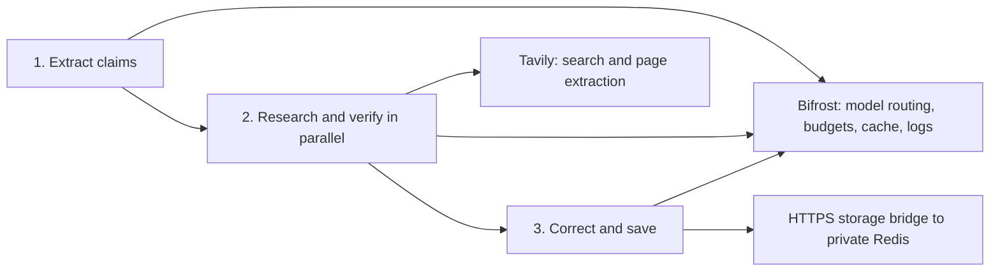

<h1 align="center">
   OffSide
</h1>

<p align="center">
  <a href="https://offside-agent.vercel.app/">Open OffSide</a>
  &nbsp;·&nbsp;
  <a href="presentations/offside-pitch-deck.pdf">Pitch Deck (PDF)</a>
</p>

AI answers can sound convincing after their facts go out of date. OffSide extracts time-sensitive claims, checks them against current web evidence, and produces a cited correction. You can paste an answer, compare answers from up to three models, or call the JSON verification API.

## Demo

https://github.com/user-attachments/assets/83292b52-b261-445a-a219-15ef28f335be

## How it works



Next.js renders the interface and consumes server-sent events from FastAPI. LangGraph runs the research stages. Bifrost uses Postgres for configuration and logs and Redis Stack for semantic caching. Each app has a separate virtual key, a monthly gateway budget, and a 60-request-per-minute gateway limit. Infrastructure charges are separate.

| Agent    | Responsibility                     | Primary model     | Effort |
| -------- | ---------------------------------- | ----------------- | ------ |
| Stepover | Extract claims and queries         | Claude Haiku 5.5  | medium |
| VAR      | Compare claims with evidence       | Claude Sonnet 5.5 | medium |
| Panenka  | Recheck up to two uncertain claims | Claude Opus 5.5   | high   |
| Golazo   | Write the cited correction         | Claude Sonnet 5.5 | low    |

Fallbacks route through Bifrost to GPT-6 Luna, GPT-6.1 Terra or GPT-6.1 Sol, depending on the agent. The diagnostics drawer reports actual served models, effort, cache hits, request IDs and usage.

Searches run concurrently with a bounded request pool. Identical searches within a run share work. Non-live searches and page extracts have short Redis caches. Only planning calls opt into the gateway cache. Evidence is ranked for relevance, recency and authority, with at most two results per domain. Quotations must match source text; unresolved claims stay unsettled.

## Local setup

Use Node.js 22 or newer and Python 3.12.

```sh
npm ci
python3.12 -m venv .venv
.venv/bin/pip install -r requirements.txt
cp .env.example .env.local
```

Set `BIFROST_URL`, the app's `BIFROST_VK`, and `TAVILY_API_KEY`. For persistent storage set `STORAGE_URL` and `STORAGE_TOKEN` for the authenticated HTTPS bridge, or use `REDIS_URL` for a local Redis server. Production requires persistent storage. With no storage configuration, local development uses memory.

Run in separate terminals:

```sh
.venv/bin/uvicorn api.index:app --reload --port 8000
npm run dev
```

The frontend forwards `/api/py/*` to `PYTHON_API_URL`, defaulting to `http://127.0.0.1:8000`. API keys stay on the server. Never prefix them with `NEXT_PUBLIC_`.

## API and verification

- `POST /api/py/check`: streaming review; body includes `answer`, optional `question`, `live` and `prefer_official`.
- `POST /api/py/verify`: the same review as JSON.
- `POST /api/py/ask`: parallel answers and reviews for supported `models`.
- `GET /api/py/models`: allowed model IDs.
- `GET /api/py/runs/{id}`: retrieve a saved result for seven days.
- `GET /api/py/health`: gateway and storage readiness.
- `/api/py/docs`: interactive API schema.

```sh
npm run lint
npm run typecheck
npm test
.venv/bin/python -m pytest api/tests -q
npm run build
```

A live smoke-test helper is available in `scripts/e2e_api.py`. Pass `--base` and a JSON `--input` file. It validates the terminal stream event and saved-result retrieval. Three local live examples completed in 16.1 to 22.0 seconds; these observations are not latency guarantees.

## Deployment and limits

Deploy this directory to the linked Vercel project with `vercel deploy --prod`. `/api/py/*` routes to the single Python entry point in `api/index.py`; implementation modules live under `backend/`. Set server environment variables for each target before deploying. The Railway storage bridge keeps Redis private and isolates each app's keys.

The hosted demo includes local snapshots. A clean clone works without them and hides the example picker.

Saved links are bearer links: anyone with the URL can open them until expiry. There is no user account system. Public research is limited to six runs per ten minutes and forty per day per client. Freshness scores summarize evidence, not certainty. Undated evidence stays unplaced on the timeline. Sources can be incomplete or wrong, and citations do not replace human judgment.

Select **Watch Answer** on a saved result to add it to the Watchlist. You can monitor up to five answers for seven days. Pathway scans their cited sources every six hours and rechecks answers when source content changes. Watchlist access is tied to this browser; clearing cookies loses access. Monitoring shares a daily research budget, so scans may pause until the next day.
